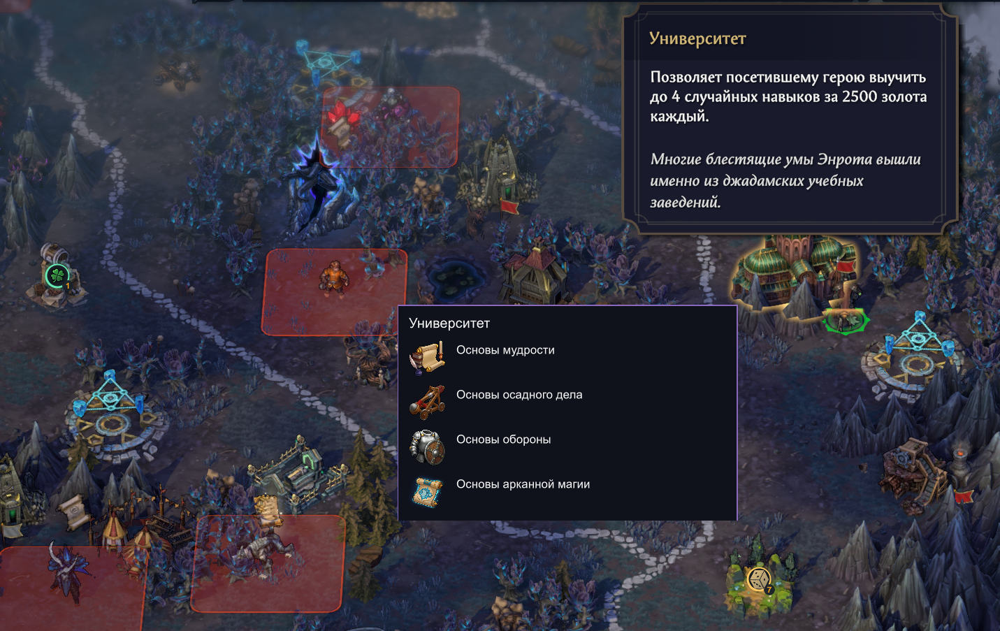

# MapHints

Мод делает подсказки на карте Heroes of Might and Magic: Olden Era заметнее. Над объектами отображаются значки наград и их доступность для выбранного героя. При наведении на посещенное здание с навыками появляется список его предложений.

**Версия 0.3.12.** Windows x64, Steam build 25672315, Unity 6000.0.66, BepInEx Unity.IL2CPP 6.0.0-be.788.

[Скачать установщик 0.3.12](https://github.com/yusha144/OldenEra-MapHints/releases/download/v0.3.12/OldenEra-MapHints-0.3.12.zip) · [Все выпуски](https://github.com/yusha144/OldenEra-MapHints/releases)

Полностью распакуйте установочный архив и запустите `Install.bat` из корня, рядом с папкой `_files`. Кнопка `Code / Download ZIP` и ссылки `Source code` скачивают исходники для разработки.

[Установка и удаление](docs/installation.md) · [Настройки](docs/settings.md) · [Обратная связь](docs/feedback.md)

## Что показывает мод

- Значки ресурсов, опыта, характеристик и временных бонусов.
- Яркие отметки доступных наград, приглушённые отметки использованных объектов и оранжевые отметки при невыполненных условиях.
- Число 7 у еженедельных наград и 1 у ежедневных.
- Разделитель **/** между наградами, из которых нужно выбрать одну.
- Известные навыки Университета, Мудрого сыча и Зловещего театра после посещения здания.
- Заметную отметку колодца, когда у выбранного героя неполная мана.

F8 переключает три режима: все отметки, доступные награды, скрытие. Размер отметок и клавишу можно изменить в [настройках](docs/settings.md).

## Поддерживаемые объекты

| Подсказки | Объекты |
|---|---|
| Ресурсы | Деревня, Пряничный домик, Мельница, Волшебный сад |
| Ресурсные хранилища | Хранилище дерева, Хранилище руды, Хранилище золота, Хранилище кристаллов, Хранилище драгоценных камней, Хранилище ртути, Хранилище алхимической пыли |
| Временные бонусы и передвижение | Пивной фонтанчик, Шепчущие камни, Груда книг, Алтарь Кииха, Конюшни, След дракона, Фонтан (оба варианта), Лагерь охотника, Слеза истины |
| Опыт | Камень знаний, Древо познания |
| Магия | Алтарь ночи, Алтарь дня, Арканный алтарь, Первородный алтарь |
| Характеристики | Автоматон Конклава, Монастырь в горах, Орден бедствующих рыцарей, Сад знаний, Магическое колесо, Живой лабиринт, Обсерватория четырёх мудрецов, Меч разящий, Весы достойных сердец |
| Восстановление маны | Колодец |
| Доступность награды | Подземный лабиринт |
| Известные навыки при наведении | Университет, Мудрый сыч, Зловещий театр |

## Пример

Университет после знакомства со зданием. На дополнительной панели видны четыре известных навыка, на карте отмечены временный бонус и случайная награда.

Полный размер открывается по нажатию на снимок.

## Установка

Распакуйте установочный архив `OldenEra-MapHints-0.3.12.zip`, закройте игру и запустите `Install.bat`. Установщик определяет папку игры и проверяет совместимость. Для первой установки нужен интернет: зависимости загружаются с серверов BepInEx.

Удаление выполняется через `Uninstall.bat`. Настройки, общий загрузчик и другие моды сохраняются. [Подробная инструкция](docs/installation.md).

## Пожелания и ошибки

[Сообщить об ошибке](https://github.com/yusha144/OldenEra-MapHints/issues/new?template=bug_report.yml) · [Предложить улучшение](https://github.com/yusha144/OldenEra-MapHints/discussions/categories/ideas) · [Обсуждение](https://github.com/yusha144/OldenEra-MapHints/discussions/categories/general) · [Вопрос по установке](https://github.com/yusha144/OldenEra-MapHints/discussions/categories/q-a)

## Исходники и лицензия

`source/` содержит код мода, `installer/` установщик, `docs/` инструкции, `development/` сборку и проверки. [Руководство разработчика](https://github.com/yusha144/OldenEra-MapHints/tree/main/development).

Автор: [yusha144](https://github.com/yusha144). Код мода, установщика и документация распространяются по [MIT](LICENSE). [Сведения о сторонних компонентах](docs/third-party-notices.md).
